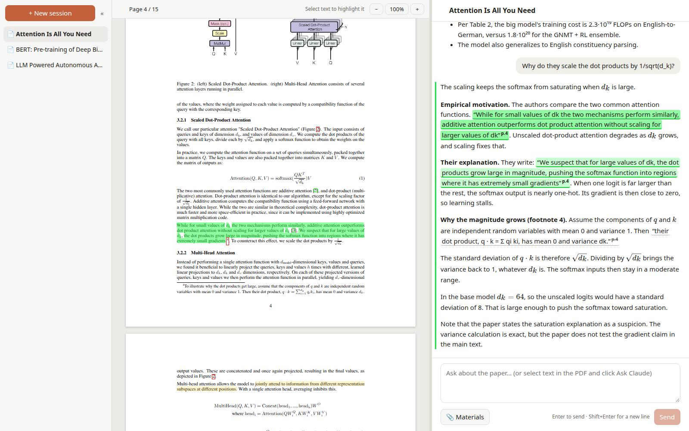
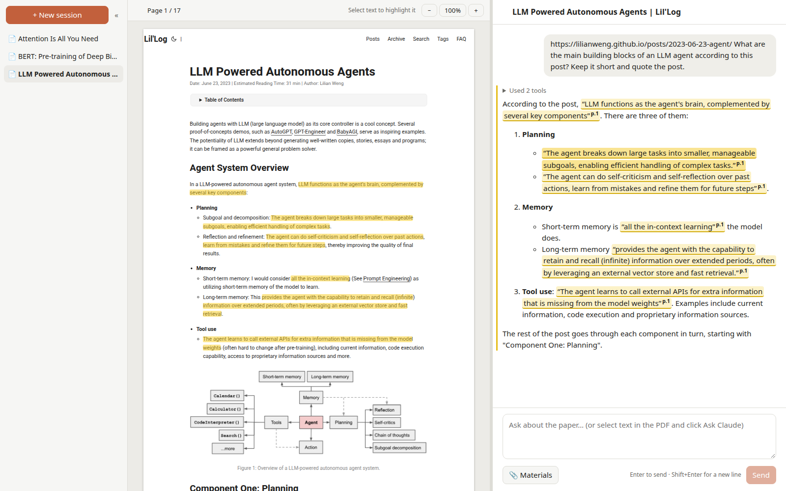
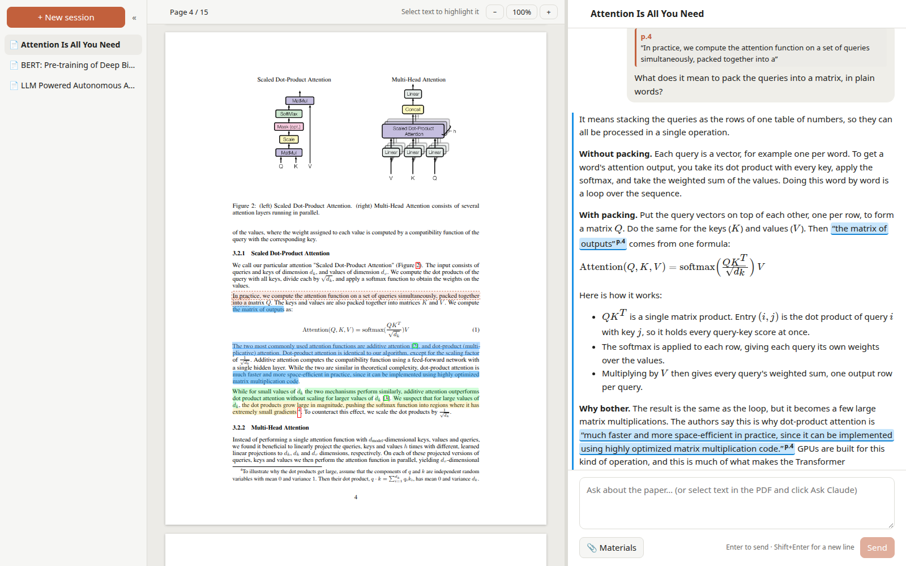

# Paper Viewer

A local web app for reading research papers together with Claude. Open a paper (a PDF file, a link to it, or a blog post), ask Claude about it, and read the answers next to the paper. Every passage Claude quotes is highlighted in the PDF and one click away.

The app is a thin front end over the **Claude Code CLI (`claude`) installed on your machine**. It does not call the Anthropic API directly; it uses whatever login, model, settings and skills your local `claude` already has.



*The paper on the left, the conversation on the right. Claude's quotes are clickable and highlighted in the PDF, one colour per answer.*

**What it does**

- **Quotes you can check:** Claude quotes the paper verbatim; each quote is highlighted in the PDF, in one colour per answer, and clicking it jumps there.
- **Papers from anywhere:** open a PDF, or paste a link (arXiv, ACL Anthology, a DOI, …). A blog post or article is saved as a PDF that looks like the website.
- **Your own highlights**, in six colours, saved with the session.
- **Ask about a passage:** select text in the PDF and ask Claude about exactly that.
- **Figures, diagrams and interactive plots in answers:** Claude can show figures cut from the paper, plots, GIFs and videos, draw diagrams, and make plots you can zoom and rotate.
- **Extra materials:** give Claude other papers, notes, images or data to draw on.
- **Saved sessions**, like any chat app; reopen one and keep asking.
- **Safe by design:** Claude runs in a sandbox and can't change anything outside the session's own folder.

## Quick start

```bash
# 1. build the front end (once, and again after changing it)
cd frontend && npm install && npm run build && cd ..

# 2. start the app (uv creates the Python environment on first run)
uv run python -m backend
```

Then open <http://127.0.0.1:8000>.

Tested on Linux (Ubuntu) with Claude Code 2.1, Python 3.13 via uv, and Node 24. macOS should work but has not been tested.

### Requirements

- Claude Code CLI installed and logged in (`claude` works in a terminal).
- [uv](https://docs.astral.sh/uv/) (manages Python 3.12 and the backend dependencies).
- Node.js 20+ (only for building the front end).
- On Linux: bubblewrap and socat (`sudo apt install bubblewrap socat`), used by Claude Code's shell sandbox. On macOS the sandbox uses the built-in Seatbelt and needs nothing extra. Windows is not supported (the sandbox doesn't run there).
- For saving web pages as PDF: Google Chrome (used if installed), or Playwright's Chromium: `uv run playwright install chromium` (one time, ~150 MB).
- Recommended: poppler-utils (`pdftotext`, `pdfimages`, `pdfinfo`), which Claude uses for better text and figure extraction.
- Optional: paper-reading skills under `~/.claude/skills/` (e.g. `paper_read_en`, `paper_read_cn`); Claude uses them when they fit.

### Configuration

All optional, set as environment variables:

| Variable | Default | Meaning |
|---|---|---|
| `PAPER_VIEWER_DATA` | `~/.paper_viewer` | Where sessions, messages and papers are stored |
| `PAPER_VIEWER_PORT` | `8000` | Port of the web server |
| `PAPER_VIEWER_HOST` | `127.0.0.1` | Address to listen on (keep it local) |
| `PAPER_VIEWER_MODEL` | CLI default | Model for Claude, e.g. `opus`, `sonnet`, `haiku` |
| `PAPER_VIEWER_CLAUDE` | `claude` on `PATH` | Path to the Claude CLI |
| `PAPER_VIEWER_MAX_MATERIAL_MB` | `50` | Size limit for each additional material |
| `PAPER_VIEWER_WEBPAGE_WIDTH` | `1000` | Width (CSS pixels) at which web pages are laid out when saved as PDF |

Example: `PAPER_VIEWER_MODEL=sonnet uv run python -m backend`

## Using the app

### Open a paper

Each session holds **one paper**; start a new session for another one. There are three ways to open it:

- **A PDF file:** click "📄 Open PDF", or drop the file onto the chat.
- **A link to a paper:** paste it into your message, e.g. `https://arxiv.org/abs/1706.03762 Summarize this paper`. The app downloads the PDF before Claude starts.
- **A link to a web page** (a blog post, an article): it is saved as a PDF that looks like the website, then read like a paper.



*A blog post saved as a PDF that looks like the website, read like a paper.*

Then ask anything, e.g. "Summarize this paper and explain the main method", "Read this critically and list the weakest assumptions", or "用中文帮我读这篇论文。" The answer streams in; the tool Claude is using is shown above it, and **Stop** ends the run. You can also chat without a paper.

If a link can't be downloaded (e.g. OpenReview, or a paywall), the reason is shown in the message's tool list and Claude still answers, using its web tools if it can; download the PDF in your browser and use "Open PDF" instead.

### Quotes and highlights

When an answer relies on the paper, Claude quotes it, and each quote appears in the chat as “quoted text”<sup>p.4</sup>:

- Each quote is highlighted in the PDF. **Each answer has its own colour**, used for its highlights, its quotes in the chat and the bar beside it; the selected answer's highlights are strong, the others faded.
- Clicking a quote selects its answer, scrolls the PDF to the passage and flashes it.
- A quote the app can't find in the PDF (Claude paraphrased) has no highlight, and its page number is struck through.

### Your own highlights, and asking about a passage

Select text in the PDF (drag, or double-click a word). A bar appears with six colours and **💬 Ask Claude**:

- **Highlight:** click a colour. Click a highlight later to change its colour or remove it (🗑). Your highlights have an underline, so they look different from Claude's.
- **Ask Claude:** the passage is attached to your next message ("Asking about p.4 …") and outlined in the PDF. Type your question, or just send for "Explain this passage." Your sent question shows the passage; click it to jump back to it.



*Asking about a selected passage. On the left, the passage is outlined, and one of your own highlights is shown in blue.*

### Figures and diagrams

Ask for them in plain words, e.g. "show me Figure 2" or "draw a diagram of the encoder":

- **Images:** Claude saves the image in the session folder (`figures/`) and shows it in its answer: a figure cut out of the paper (with `pdftoppm`), a plot it made (needs Python with matplotlib on your machine), an animated GIF, or a video (`.mp4`, `.webm`). Click an image to open it full size.
- **Diagrams:** flows, architectures and timelines are written as [Mermaid](https://mermaid.js.org) and drawn in the chat once the answer is complete.
- **Interactive plots:** ask for a plot you can explore, e.g. "plot the learning rate schedule" or "a 3D surface I can rotate". Claude writes it as a [Plotly](https://plotly.com/javascript/) figure (data only, no code); drag to zoom or rotate, scroll to zoom in 3D, hover for values, double-click to reset. Large plots are saved as `figures/*.plotly.json`.

### Additional materials

Give Claude extra files to draw on: other papers, notes, images, data, anything.

- Click **📎 Materials** and pick one or more files, at any time; dropping files onto the chat works too.
- Materials aren't displayed. The chat header shows "📎 N materials"; click it to see the list and remove files.
- With your next message, Claude is told what was added or removed and reads the new files. It names the file when it uses one; clickable quotes stay reserved for the paper.

### Sessions

- Every session is saved automatically: the paper, messages, highlights and materials. Click one in the sidebar to reopen it and keep asking; Claude continues the same conversation.
- The title is the paper's title. Rename with ✎ or a double-click; delete with 🗑.
- If you close the page while Claude is answering, the answer is still finished and saved.

## How it works

| Part | Choice |
|---|---|
| Backend | Python 3.12, FastAPI, Uvicorn; managed with uv |
| Storage | SQLite (one file in the data folder) |
| Front end | React + TypeScript, built with Vite |
| PDF rendering | PDF.js via `react-pdf` (its text layer is used for highlighting) |
| Chat rendering | `react-markdown` with GFM tables, KaTeX math, Mermaid diagrams and Plotly charts (both loaded only when an answer uses them) |
| Web page capture | Playwright driving headless Chrome |

The backend also serves the built front end, so there is one process and one port.

```
┌──────────────────────── Browser ────────────────────────┐
│  PDF pane (PDF.js)          │  Chat pane                │
│  - render pages             │  - messages (streamed)    │
│  - index page text          │  - input box, Stop        │
│  - find quotes, highlight   │  - clickable quotes       │
└──────────────┬──────────────┴──────────────┬────────────┘
               │  HTTP, answers streamed as NDJSON       │
┌──────────────┴──────────────────────────────┴────────────┐
│  Backend (FastAPI)                                       │
│  - stores sessions and messages in SQLite                │
│  - stores the PDF, serves it to the browser              │
│  - downloads papers, saves web pages as PDF              │
│  - runs `claude -p` per message, in the session folder   │
│  - streams Claude's text and tool calls to the browser   │
└──────────────────────────────┬───────────────────────────┘
                               │
                       local `claude` CLI
              (your login, model, settings, skills)
```

### Project layout

```
backend/
  __main__.py          start the server (`python -m backend`)
  app.py               HTTP API and static files
  claude_runner.py     runs `claude`: system prompt, permissions, streaming
  papers.py            storing the paper, title detection, downloading from links, materials
  webpage.py           saving a web page as a PDF that looks like the site
  db.py                SQLite schema and queries
  config.py            paths and environment variables
  hooks/check_paths.py hook that keeps Write/Edit inside the session folder
frontend/src/
  App.tsx              layout, sessions, sending messages, materials
  PdfPane.tsx          PDF rendering, highlights, selection bar, scroll-to-quote, zoom
  MessageView.tsx      one chat message: Markdown, quotes, tool list
  Media.tsx            images, GIFs, videos, Mermaid diagrams and Plotly charts in answers
  citations.ts         parsing <cite> tags, finding quotes and highlights in the PDF text
  api.ts               calls to the backend
```

### From a link to a PDF

If the session has no paper and the message contains links, the backend tries them before Claude starts (up to 3, first success wins):

1. Known sites are mapped straight to their PDF: arXiv (`/abs/`, `/pdf/`, `/html/`), Hugging Face papers and alphaXiv (via arXiv), OpenReview, ACL Anthology, bioRxiv / medRxiv, NeurIPS proceedings, CVF open access.
2. Any other link is fetched. A PDF is used as is; for a web page, the app follows its `citation_pdf_url` tag, which most publishers set (e.g. DOI links to Nature).
3. A web page with no PDF behind it is saved as a PDF that looks like the page (below).

Downloads are limited to 100 MB and checked to really be PDFs. Tested: arXiv, Hugging Face, ACL Anthology, NeurIPS, CVF, bioRxiv, Nature (direct and via `doi.org`). OpenReview requires a browser check before downloads, which the app does not try to get around.

**Saving a web page.** Like Zotero's snapshots, but as a PDF: the app opens the page in headless Chrome and prints it with the page's *screen* styles (not its print stylesheet), backgrounds and images, at a desktop width of 1000 px, in pages of A4 proportions. The PDF has the page's real text, not a screenshot, so selecting, highlighting and quotes work as with a paper. Before printing, the app scrolls through the page so lazily loaded images appear, hides cookie dialogs and other overlays, lets sticky headers scroll with the page (so they don't repeat on every page), and undoes scroll locks. It takes 5–10 seconds; tested with Lil'Log, Karpathy's blog, the Illustrated Transformer, Distill and The Guardian.

### Talking to the Claude CLI

Each user message runs:

```bash
claude -p --output-format stream-json --verbose --include-partial-messages \
  --permission-mode dontAsk --settings '<generated JSON>' \
  --append-system-prompt '<paper viewer instructions>' \
  --session-id <new uuid>      # first message
  --resume <saved uuid>        # every later message
```

- The message is passed on standard input; the working directory is the session folder.
- Notes are added in front of the message when needed: that the paper is `./paper.pdf` (or a saved web page), which materials were added or removed, or which passage a question is about (`[The user selected this passage on page N …]` followed by the passage).
- Follow-up messages use `--resume`, so Claude keeps the paper and the conversation in context.
- The run is a background task on the server: it is saved even if the browser disconnects.
- If Claude can't resume its session (its history under `~/.claude/` was deleted), the backend starts a new Claude session and sends the saved transcript along with the new message.
- The system prompt is `SYSTEM_PROMPT` in `claude_runner.py` (about 800 tokens), added to Claude Code's own prompt with `--append-system-prompt`. It explains the citation format, materials, figures, diagrams and plots, formatting and the sandbox rules. `--system-prompt-snapshot off` makes every message use the current prompt; by default Claude Code keeps the prompt a conversation started with, so changes would only reach new sessions.

### Citations

Claude is told to quote supporting passages inline in its sentences, like this:

```
The authors propose <cite page="1">a new simple network architecture, the Transformer</cite>, which ...
```

`page` is the 1-based page index in the PDF file; the content is a verbatim quote of at most about 30 words. The front end then:

1. Indexes the text of every page with PDF.js. Matching ignores case, spaces, punctuation, line-break hyphens and ligatures, so a quote still matches across line breaks.
2. Looks for the quote on the cited page, then the pages next to it, then everywhere (Claude sometimes gets the page wrong). Long quotes with a small difference in the middle still match by their start and end.
3. Marks the matched characters in the PDF text layer, in the answer's colour, and shows the quote in the chat as a clickable quotation.

Answer colours: the first 10 answers with quotes get 10 well-separated hues (yellow, green, blue, pink, orange, purple, teal, red, lime, indigo); after that, each new hue is 137.5° (the golden angle) from the previous one, so consecutive answers stay far apart.

User highlights are stored by their position in the page's text items and by their text; if the position no longer matches (e.g. after a PDF.js update), they are found again by their text, like quotes.

### Tool permissions

Rule: **Claude may run any command, as long as it changes nothing outside the session's folder.**

Inside the session folder Claude is free to work: extract text, pull out figures, write scratch files, run a Python script to check a number. Outside it, nothing may change.

| Allowed | Blocked |
|---|---|
| Any shell command, e.g. `pdftotext`, `pdfimages`, `python`, `grep` | Writing, moving or deleting anything outside the session folder |
| Creating files in the session folder (`Bash`, `Write`, `Edit`) | Changing `paper.pdf` or the files in `materials/` |
| Reading files (`Read`, `Glob`, `Grep`) | `sudo`, `su`, `kill`, `pkill`, `killall`, `systemctl`, `shutdown`, `reboot`, `crontab` |
| `WebSearch`, `WebFetch`, `Skill`, `TodoWrite`, subagents (`Task`) | Network access from shell commands (use `WebSearch` / `WebFetch`) |
| | MCP tools (not on the allow list) |

The settings are generated for each run by `claude_settings()` in `backend/claude_runner.py` and passed with `--settings`. Four layers enforce them:

1. **OS sandbox for shell commands.** `sandbox.enabled` turns on Claude Code's Bash sandbox (bubblewrap on Linux). Commands can write only to the working directory and to Claude's own temporary folder (`/tmp/claude-<uid>`), and have no network. `allowUnsandboxedCommands: false` stops Claude from retrying a command outside the sandbox.
2. **A hook for file tools.** `Write`, `Edit`, `MultiEdit` and `NotebookEdit` don't go through the sandbox, so a `PreToolUse` hook (`backend/hooks/check_paths.py`) resolves the target path (following `..` and symlinks) and refuses anything outside the session folder, `paper.pdf` itself, and the `materials/` folder.
3. **Allow and deny lists.** `--permission-mode dontAsk` refuses every tool that isn't explicitly allowed, without prompting. The allow list holds the tools in the table, including `Bash`: every shell command runs in the sandbox anyway, and without this, commands the sandbox doesn't approve on its own (e.g. ones with `$(...)`) would be refused. The deny list holds the system commands above, and takes priority.
4. **Protecting the paper.** `paper.pdf` and the materials are read-only. After every run the backend compares the paper's SHA-256 with the original and restores it from the backup in `originals/` if it changed. The browser is always served the backup.

When a call is refused, Claude sees why and can try another way.

### Data folder

```
~/.paper_viewer/
├── paper_viewer.db          # SQLite: sessions, messages, highlights, materials
├── originals/
│   └── <session-id>.pdf     # untouched copy of the paper (outside the sandbox)
└── papers/
    └── <session-id>/        # Claude's working directory; the only place it can write
        ├── paper.pdf        # the paper (read-only)
        ├── materials/       # additional materials the user added (read-only)
        └── ...              # anything Claude creates: extracted text, figures, scripts
```

- `sessions`: id, title, original file name, SHA-256 of the PDF, Claude session id, whether Claude has been told about the PDF, times.
- `messages`: id, session id, role, text, tools used, error (e.g. "Stopped by user."), the PDF passage a question is about, time. Quotes are part of the message text and are found in the PDF again when a session is opened.
- `highlights`: id, session id, page, ranges (`[itemIndex, start, end]` in the page's text items), selected text, colour, time.
- `materials`: id, session id, file name, size, whether Claude has been told about it, whether it was removed (until Claude is told), time.
- Claude's own conversation history is kept by the CLI under `~/.claude/projects/`. By default Claude Code deletes history older than 30 days; the app then continues from its own saved transcript.
- Deleting a session removes its rows, its folder and its backup PDF. Columns added in later versions are added to existing databases automatically on startup.

### HTTP API

| Method and path | Purpose |
|---|---|
| `GET /api/sessions` | List sessions, newest first |
| `POST /api/sessions` | Create an empty session |
| `GET /api/sessions/{id}` | Session, its messages, highlights and materials |
| `PATCH /api/sessions/{id}` | Rename (`{"title": ...}`) |
| `DELETE /api/sessions/{id}` | Delete the session, its folder and its PDF |
| `POST /api/sessions/{id}/pdf` | Upload the paper (multipart `file`); only once per session |
| `GET /api/sessions/{id}/pdf` | The paper |
| `GET /api/sessions/{id}/files/{path}` | A file from the session folder (e.g. an image in an answer); only inside the folder, served with a no-scripts Content-Security-Policy |
| `POST /api/sessions/{id}/messages` | Send `{"text": ..., "selection": {"page", "ranges", "text"} or null}`; the response is a stream of JSON lines: `text` (a piece of the answer), `tool` (a tool call, including `Download`), `pdf` (the paper was downloaded from a link), `done` (the saved answer) |
| `POST /api/sessions/{id}/stop` | Stop the current answer |
| `POST /api/sessions/{id}/highlights` | Save a user highlight (`page`, `ranges`, `text`, `color`) |
| `PATCH /api/sessions/{id}/highlights/{hid}` | Change its colour (`{"color": ...}`) |
| `DELETE /api/sessions/{id}/highlights/{hid}` | Remove it |
| `POST /api/sessions/{id}/materials` | Add materials (multipart, one or more `files`) |
| `DELETE /api/sessions/{id}/materials/{mid}` | Remove a material |

## Development

Run the backend and the Vite dev server side by side; the dev server reloads the UI on every change and forwards `/api` to the backend:

```bash
uv run python -m backend          # terminal 1, port 8000
cd frontend && npm run dev        # terminal 2, open the URL it prints
```

## Known limitations

- Quotes from equations, tables and figures usually can't be highlighted, because the PDF text there is not in reading order. Claude is told to quote the surrounding sentence instead.
- Scanned PDFs without a text layer can't be highlighted.
- Paper links from OpenReview and paywalled publishers can't be downloaded automatically; open the PDF by hand instead.
- When a session has no paper yet, the first link in a message becomes the paper: a PDF if there is one, else the web page saved as PDF. That includes links you only meant to mention (e.g. a GitHub page); start a new session if that happens.
- Saved web pages: pages behind a login or a bot check ("verify you are human") can't be saved, and pages that build their content only after interaction may come out incomplete. A page break can cut through a line of text or an image, and unusual layouts (e.g. content in an inner scrolling box) may be cut off.
- A highlight or a selection that runs onto the next page is cut at the end of the first page.
- All pages are rendered at once; very long documents (hundreds of pages) may be slow.
- The server only listens on localhost: there is one user, and no remote access.
